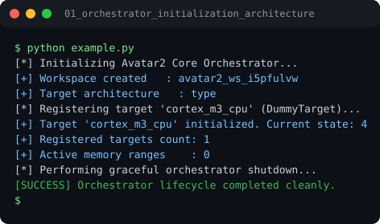

# Run report: 01_orchestrator_initialization_architecture

Generated by `run_all_and_log.py`; everything below comes from a real local run of `example.py`.

## Status

| Field | Value |
|:--|:--|
| Example | `01_orchestrator_initialization_architecture` |
| Status | **PASS** |
| Exit code | `0` |
| Duration | 0.63 s |
| Output lines | 9 |
| Output size | 403 B |
| Command | `python example.py`, `./run.sh` or `.\run.ps1` (inside the example folder) |
| Interpreter | `python 3.12.0` |
| Artifacts | [run.log](run.log) - [run_screenshot.svg](run_screenshot.svg) - [Telegram PNG](../telegram_assets/01_orchestrator_initialization_architecture.png) |

## Screenshot



Telegram-ready raster copy: [`../telegram_assets/01_orchestrator_initialization_architecture.png`](../telegram_assets/01_orchestrator_initialization_architecture.png)

## Output

```text
[*] Initializing Avatar2 Core Orchestrator...
[+] Workspace created   : avatar2_ws_i5pfulvw
[+] Target architecture   : type
[*] Registering target 'cortex_m3_cpu' (DummyTarget)...
[+] Target 'cortex_m3_cpu' initialized. Current state: 4
[+] Registered targets count: 1
[+] Active memory ranges    : 0
[*] Performing graceful orchestrator shutdown...
[SUCCESS] Orchestrator lifecycle completed cleanly.
```
