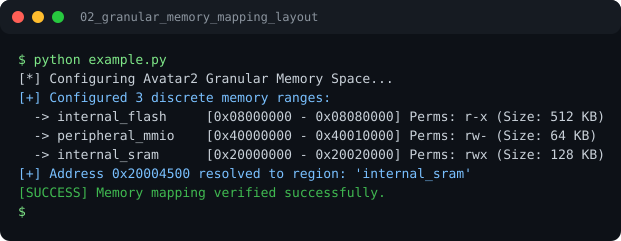

# Run report: 02_granular_memory_mapping_layout

Generated by `run_all_and_log.py`; everything below comes from a real local run of `example.py`.

## Status

| Field | Value |
|:--|:--|
| Example | `02_granular_memory_mapping_layout` |
| Status | **PASS** |
| Exit code | `0` |
| Duration | 0.75 s |
| Output lines | 7 |
| Output size | 424 B |
| Command | `python example.py`, `./run.sh` or `.\run.ps1` (inside the example folder) |
| Interpreter | `python 3.12.0` |
| Artifacts | [run.log](run.log) - [run_screenshot.svg](run_screenshot.svg) - [Telegram PNG](../telegram_assets/02_granular_memory_mapping_layout.png) |

## Screenshot



Telegram-ready raster copy: [`../telegram_assets/02_granular_memory_mapping_layout.png`](../telegram_assets/02_granular_memory_mapping_layout.png)

## Output

```text
[*] Configuring Avatar2 Granular Memory Space...
[+] Configured 3 discrete memory ranges:
  -> internal_flash     [0x08000000 - 0x08080000] Perms: r-x (Size: 512 KB)
  -> peripheral_mmio    [0x40000000 - 0x40010000] Perms: rw- (Size: 64 KB)
  -> internal_sram      [0x20000000 - 0x20020000] Perms: rwx (Size: 128 KB)
[+] Address 0x20004500 resolved to region: 'internal_sram'
[SUCCESS] Memory mapping verified successfully.
```
