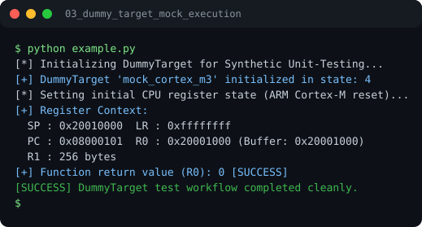

# Run report: 03_dummy_target_mock_execution

Generated by `run_all_and_log.py`; everything below comes from a real local run of `example.py`.

## Status

| Field | Value |
|:--|:--|
| Example | `03_dummy_target_mock_execution` |
| Status | **PASS** |
| Exit code | `0` |
| Duration | 0.79 s |
| Output lines | 9 |
| Output size | 408 B |
| Command | `python example.py`, `./run.sh` or `.\run.ps1` (inside the example folder) |
| Interpreter | `python 3.12.0` |
| Artifacts | [run.log](run.log) - [run_screenshot.svg](run_screenshot.svg) - [Telegram PNG](../telegram_assets/03_dummy_target_mock_execution.png) |

## Screenshot



Telegram-ready raster copy: [`../telegram_assets/03_dummy_target_mock_execution.png`](../telegram_assets/03_dummy_target_mock_execution.png)

## Output

```text
[*] Initializing DummyTarget for Synthetic Unit-Testing...
[+] DummyTarget 'mock_cortex_m3' initialized in state: 4
[*] Setting initial CPU register state (ARM Cortex-M reset)...
[+] Register Context:
  SP : 0x20010000  LR : 0xffffffff
  PC : 0x08000101  R0 : 0x20001000 (Buffer: 0x20001000)
  R1 : 256 bytes
[+] Function return value (R0): 0 [SUCCESS]
[SUCCESS] DummyTarget test workflow completed cleanly.
```
