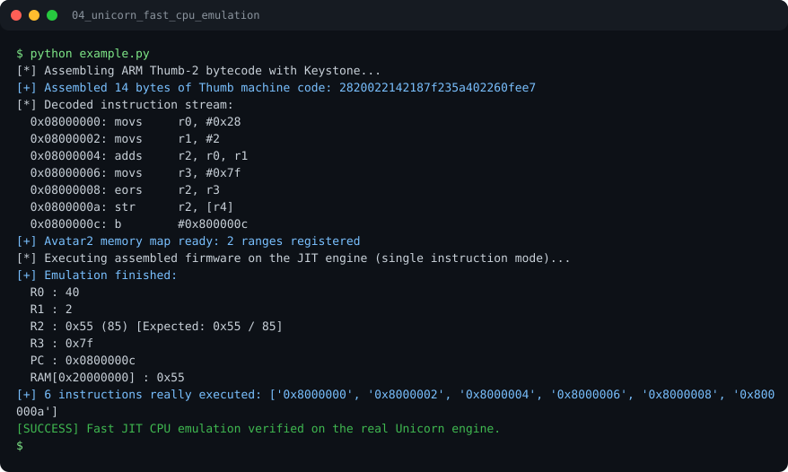

# Run report: 04_unicorn_fast_cpu_emulation

Generated by `run_all_and_log.py`; everything below comes from a real local run of `example.py`.

## Status

| Field | Value |
|:--|:--|
| Example | `04_unicorn_fast_cpu_emulation` |
| Status | **PASS** |
| Exit code | `0` |
| Duration | 0.78 s |
| Output lines | 21 |
| Output size | 838 B |
| Command | `python example.py`, `./run.sh` or `.\run.ps1` (inside the example folder) |
| Interpreter | `python 3.12.0` |
| Artifacts | [run.log](run.log) - [run_screenshot.svg](run_screenshot.svg) - [Telegram PNG](../telegram_assets/04_unicorn_fast_cpu_emulation.png) |

## Screenshot



Telegram-ready raster copy: [`../telegram_assets/04_unicorn_fast_cpu_emulation.png`](../telegram_assets/04_unicorn_fast_cpu_emulation.png)

## Output

```text
[*] Assembling ARM Thumb-2 bytecode with Keystone...
[+] Assembled 14 bytes of Thumb machine code: 2820022142187f235a402260fee7
[*] Decoded instruction stream:
  0x08000000: movs     r0, #0x28
  0x08000002: movs     r1, #2
  0x08000004: adds     r2, r0, r1
  0x08000006: movs     r3, #0x7f
  0x08000008: eors     r2, r3
  0x0800000a: str      r2, [r4]
  0x0800000c: b        #0x800000c
[+] Avatar2 memory map ready: 2 ranges registered
[*] Executing assembled firmware on the JIT engine (single instruction mode)...
[+] Emulation finished:
  R0 : 40
  R1 : 2
  R2 : 0x55 (85) [Expected: 0x55 / 85]
  R3 : 0x7f
  PC : 0x0800000c
  RAM[0x20000000] : 0x55
[+] 6 instructions really executed: ['0x8000000', '0x8000002', '0x8000004', '0x8000006', '0x8000008', '0x800000a']
[SUCCESS] Fast JIT CPU emulation verified on the real Unicorn engine.
```
