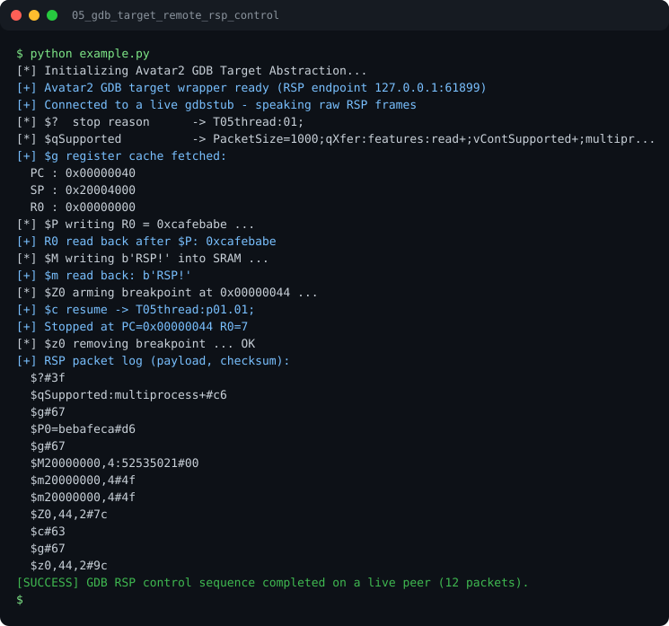

# Run report: 05_gdb_target_remote_rsp_control

Generated by `run_all_and_log.py`; everything below comes from a real local run of `example.py`.

## Status

| Field | Value |
|:--|:--|
| Example | `05_gdb_target_remote_rsp_control` |
| Status | **PASS** |
| Exit code | `0` |
| Duration | 1.25 s |
| Output lines | 31 |
| Output size | 974 B |
| Command | `python example.py`, `./run.sh` or `.\run.ps1` (inside the example folder) |
| Interpreter | `python 3.12.0` |
| Artifacts | [run.log](run.log) - [run_screenshot.svg](run_screenshot.svg) - [Telegram PNG](../telegram_assets/05_gdb_target_remote_rsp_control.png) |

## Screenshot



Telegram-ready raster copy: [`../telegram_assets/05_gdb_target_remote_rsp_control.png`](../telegram_assets/05_gdb_target_remote_rsp_control.png)

## Output

```text
[*] Initializing Avatar2 GDB Target Abstraction...
[+] Avatar2 GDB target wrapper ready (RSP endpoint 127.0.0.1:61899)
[+] Connected to a live gdbstub - speaking raw RSP frames
[*] $?  stop reason      -> T05thread:01;
[*] $qSupported          -> PacketSize=1000;qXfer:features:read+;vContSupported+;multipr...
[+] $g register cache fetched:
  PC : 0x00000040
  SP : 0x20004000
  R0 : 0x00000000
[*] $P writing R0 = 0xcafebabe ...
[+] R0 read back after $P: 0xcafebabe
[*] $M writing b'RSP!' into SRAM ...
[+] $m read back: b'RSP!'
[*] $Z0 arming breakpoint at 0x00000044 ...
[+] $c resume -> T05thread:p01.01;
[+] Stopped at PC=0x00000044 R0=7
[*] $z0 removing breakpoint ... OK
[+] RSP packet log (payload, checksum):
  $?#3f
  $qSupported:multiprocess+#c6
  $g#67
  $P0=bebafeca#d6
  $g#67
  $M20000000,4:52535021#00
  $m20000000,4#4f
  $m20000000,4#4f
  $Z0,44,2#7c
  $c#63
  $g#67
  $z0,44,2#9c
[SUCCESS] GDB RSP control sequence completed on a live peer (12 packets).
```
