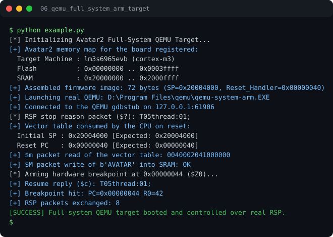

# Run report: 06_qemu_full_system_arm_target

Generated by `run_all_and_log.py`; everything below comes from a real local run of `example.py`.

## Status

| Field | Value |
|:--|:--|
| Example | `06_qemu_full_system_arm_target` |
| Status | **PASS** |
| Exit code | `0` |
| Duration | 1.29 s |
| Output lines | 19 |
| Output size | 960 B |
| Command | `python example.py`, `./run.sh` or `.\run.ps1` (inside the example folder) |
| Interpreter | `python 3.12.0` |
| Artifacts | [run.log](run.log) - [run_screenshot.svg](run_screenshot.svg) - [Telegram PNG](../telegram_assets/06_qemu_full_system_arm_target.png) |

## Screenshot



Telegram-ready raster copy: [`../telegram_assets/06_qemu_full_system_arm_target.png`](../telegram_assets/06_qemu_full_system_arm_target.png)

## Output

```text
[*] Initializing Avatar2 Full-System QEMU Target...
[+] Avatar2 memory map for the board registered:
  Target Machine : lm3s6965evb (cortex-m3)
  Flash          : 0x00000000 .. 0x0003ffff
  SRAM           : 0x20000000 .. 0x2000ffff
[+] Assembled firmware image: 72 bytes (SP=0x20004000, Reset_Handler=0x00000040)
[+] Launching real QEMU: D:\Program Files\qemu\qemu-system-arm.EXE
[+] Connected to the QEMU gdbstub on 127.0.0.1:61906
[*] RSP stop reason packet ($?): T05thread:01;
[+] Vector table consumed by the CPU on reset:
  Initial SP : 0x20004000 [Expected: 0x20004000]
  Reset PC   : 0x00000040 [Expected: 0x00000040]
[+] $m packet read of the vector table: 0040002041000000
[+] $M packet write of b'AVATAR' into SRAM: OK
[*] Arming hardware breakpoint at 0x00000044 ($Z0)...
[+] Resume reply ($c): T05thread:01;
[+] Breakpoint hit: PC=0x00000044 R0=42
[+] RSP packets exchanged: 8
[SUCCESS] Full-system QEMU target booted and controlled over real RSP.
```
