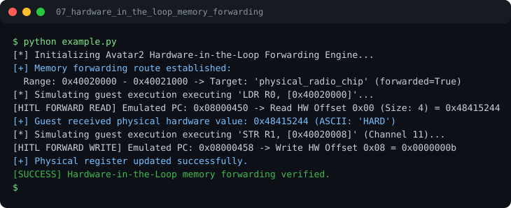

# Run report: 07_hardware_in_the_loop_memory_forwarding

Generated by `run_all_and_log.py`; everything below comes from a real local run of `example.py`.

## Status

| Field | Value |
|:--|:--|
| Example | `07_hardware_in_the_loop_memory_forwarding` |
| Status | **PASS** |
| Exit code | `0` |
| Duration | 0.76 s |
| Output lines | 10 |
| Output size | 684 B |
| Command | `python example.py`, `./run.sh` or `.\run.ps1` (inside the example folder) |
| Interpreter | `python 3.12.0` |
| Artifacts | [run.log](run.log) - [run_screenshot.svg](run_screenshot.svg) - [Telegram PNG](../telegram_assets/07_hardware_in_the_loop_memory_forwarding.png) |

## Screenshot



Telegram-ready raster copy: [`../telegram_assets/07_hardware_in_the_loop_memory_forwarding.png`](../telegram_assets/07_hardware_in_the_loop_memory_forwarding.png)

## Output

```text
[*] Initializing Avatar2 Hardware-in-the-Loop Forwarding Engine...
[+] Memory forwarding route established:
  Range: 0x40020000 - 0x40021000 -> Target: 'physical_radio_chip' (forwarded=True)
[*] Simulating guest execution executing 'LDR R0, [0x40020000]'...
[HITL FORWARD READ] Emulated PC: 0x08000450 -> Read HW Offset 0x00 (Size: 4) = 0x48415244
[+] Guest received physical hardware value: 0x48415244 (ASCII: 'HARD')
[*] Simulating guest execution executing 'STR R1, [0x40020008]' (Channel 11)...
[HITL FORWARD WRITE] Emulated PC: 0x08000458 -> Write HW Offset 0x08 = 0x0000000b
[+] Physical register updated successfully.
[SUCCESS] Hardware-in-the-Loop memory forwarding verified.
```
