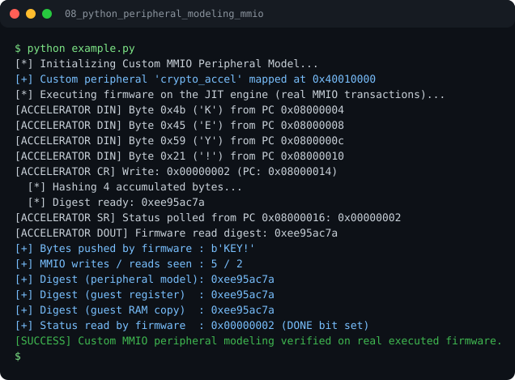

# Run report: 08_python_peripheral_modeling_mmio

Generated by `run_all_and_log.py`; everything below comes from a real local run of `example.py`.

## Status

| Field | Value |
|:--|:--|
| Example | `08_python_peripheral_modeling_mmio` |
| Status | **PASS** |
| Exit code | `0` |
| Duration | 0.78 s |
| Output lines | 19 |
| Output size | 959 B |
| Command | `python example.py`, `./run.sh` or `.\run.ps1` (inside the example folder) |
| Interpreter | `python 3.12.0` |
| Artifacts | [run.log](run.log) - [run_screenshot.svg](run_screenshot.svg) - [Telegram PNG](../telegram_assets/08_python_peripheral_modeling_mmio.png) |

## Screenshot



Telegram-ready raster copy: [`../telegram_assets/08_python_peripheral_modeling_mmio.png`](../telegram_assets/08_python_peripheral_modeling_mmio.png)

## Output

```text
[*] Initializing Custom MMIO Peripheral Model...
[+] Custom peripheral 'crypto_accel' mapped at 0x40010000
[*] Executing firmware on the JIT engine (real MMIO transactions)...
[ACCELERATOR DIN] Byte 0x4b ('K') from PC 0x08000004
[ACCELERATOR DIN] Byte 0x45 ('E') from PC 0x08000008
[ACCELERATOR DIN] Byte 0x59 ('Y') from PC 0x0800000c
[ACCELERATOR DIN] Byte 0x21 ('!') from PC 0x08000010
[ACCELERATOR CR] Write: 0x00000002 (PC: 0x08000014)
  [*] Hashing 4 accumulated bytes...
  [*] Digest ready: 0xee95ac7a
[ACCELERATOR SR] Status polled from PC 0x08000016: 0x00000002
[ACCELERATOR DOUT] Firmware read digest: 0xee95ac7a
[+] Bytes pushed by firmware : b'KEY!'
[+] MMIO writes / reads seen : 5 / 2
[+] Digest (peripheral model): 0xee95ac7a
[+] Digest (guest register)  : 0xee95ac7a
[+] Digest (guest RAM copy)  : 0xee95ac7a
[+] Status read by firmware  : 0x00000002 (DONE bit set)
[SUCCESS] Custom MMIO peripheral modeling verified on real executed firmware.
```
