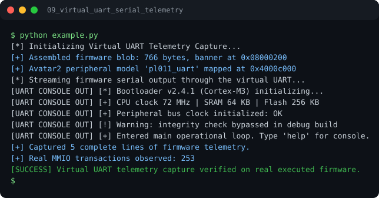

# Run report: 09_virtual_uart_serial_telemetry

Generated by `run_all_and_log.py`; everything below comes from a real local run of `example.py`.

## Status

| Field | Value |
|:--|:--|
| Example | `09_virtual_uart_serial_telemetry` |
| Status | **PASS** |
| Exit code | `0` |
| Duration | 0.77 s |
| Output lines | 12 |
| Output size | 759 B |
| Command | `python example.py`, `./run.sh` or `.\run.ps1` (inside the example folder) |
| Interpreter | `python 3.12.0` |
| Artifacts | [run.log](run.log) - [run_screenshot.svg](run_screenshot.svg) - [Telegram PNG](../telegram_assets/09_virtual_uart_serial_telemetry.png) |

## Screenshot



Telegram-ready raster copy: [`../telegram_assets/09_virtual_uart_serial_telemetry.png`](../telegram_assets/09_virtual_uart_serial_telemetry.png)

## Output

```text
[*] Initializing Virtual UART Telemetry Capture...
[+] Assembled firmware blob: 766 bytes, banner at 0x08000200
[+] Avatar2 peripheral model 'pl011_uart' mapped at 0x4000c000
[*] Streaming firmware serial output through the virtual UART...
[UART CONSOLE OUT] [*] Bootloader v2.4.1 (Cortex-M3) initializing...
[UART CONSOLE OUT] [+] CPU clock 72 MHz | SRAM 64 KB | Flash 256 KB
[UART CONSOLE OUT] [+] Peripheral bus clock initialized: OK
[UART CONSOLE OUT] [!] Warning: integrity check bypassed in debug build
[UART CONSOLE OUT] [+] Entered main operational loop. Type 'help' for console.
[+] Captured 5 complete lines of firmware telemetry.
[+] Real MMIO transactions observed: 253
[SUCCESS] Virtual UART telemetry capture verified on real executed firmware.
```
