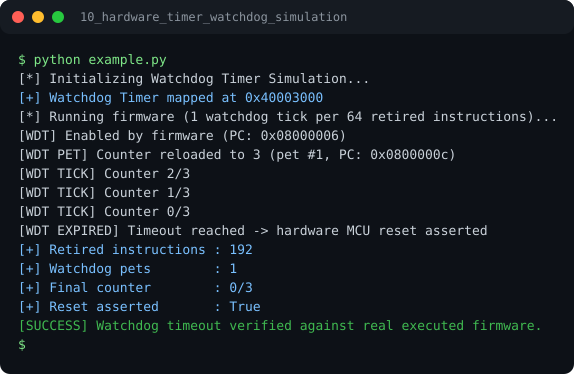

# Run report: 10_hardware_timer_watchdog_simulation

Generated by `run_all_and_log.py`; everything below comes from a real local run of `example.py`.

## Status

| Field | Value |
|:--|:--|
| Example | `10_hardware_timer_watchdog_simulation` |
| Status | **PASS** |
| Exit code | `0` |
| Duration | 0.65 s |
| Output lines | 14 |
| Output size | 577 B |
| Command | `python example.py`, `./run.sh` or `.\run.ps1` (inside the example folder) |
| Interpreter | `python 3.12.0` |
| Artifacts | [run.log](run.log) - [run_screenshot.svg](run_screenshot.svg) - [Telegram PNG](../telegram_assets/10_hardware_timer_watchdog_simulation.png) |

## Screenshot



Telegram-ready raster copy: [`../telegram_assets/10_hardware_timer_watchdog_simulation.png`](../telegram_assets/10_hardware_timer_watchdog_simulation.png)

## Output

```text
[*] Initializing Watchdog Timer Simulation...
[+] Watchdog Timer mapped at 0x40003000
[*] Running firmware (1 watchdog tick per 64 retired instructions)...
[WDT] Enabled by firmware (PC: 0x08000006)
[WDT PET] Counter reloaded to 3 (pet #1, PC: 0x0800000c)
[WDT TICK] Counter 2/3
[WDT TICK] Counter 1/3
[WDT TICK] Counter 0/3
[WDT EXPIRED] Timeout reached -> hardware MCU reset asserted
[+] Retired instructions : 192
[+] Watchdog pets        : 1
[+] Final counter        : 0/3
[+] Reset asserted       : True
[SUCCESS] Watchdog timeout verified against real executed firmware.
```
