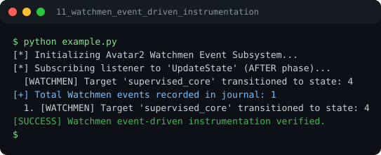

# Run report: 11_watchmen_event_driven_instrumentation

Generated by `run_all_and_log.py`; everything below comes from a real local run of `example.py`.

## Status

| Field | Value |
|:--|:--|
| Example | `11_watchmen_event_driven_instrumentation` |
| Status | **PASS** |
| Exit code | `0` |
| Duration | 0.87 s |
| Output lines | 6 |
| Output size | 348 B |
| Command | `python example.py`, `./run.sh` or `.\run.ps1` (inside the example folder) |
| Interpreter | `python 3.12.0` |
| Artifacts | [run.log](run.log) - [run_screenshot.svg](run_screenshot.svg) - [Telegram PNG](../telegram_assets/11_watchmen_event_driven_instrumentation.png) |

## Screenshot



Telegram-ready raster copy: [`../telegram_assets/11_watchmen_event_driven_instrumentation.png`](../telegram_assets/11_watchmen_event_driven_instrumentation.png)

## Output

```text
[*] Initializing Avatar2 Watchmen Event Subsystem...
[*] Subscribing listener to 'UpdateState' (AFTER phase)...
  [WATCHMEN] Target 'supervised_core' transitioned to state: 4
[+] Total Watchmen events recorded in journal: 1
  1. [WATCHMEN] Target 'supervised_core' transitioned to state: 4
[SUCCESS] Watchmen event-driven instrumentation verified.
```
