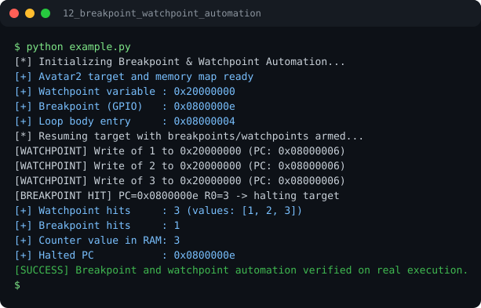

# Run report: 12_breakpoint_watchpoint_automation

Generated by `run_all_and_log.py`; everything below comes from a real local run of `example.py`.

## Status

| Field | Value |
|:--|:--|
| Example | `12_breakpoint_watchpoint_automation` |
| Status | **PASS** |
| Exit code | `0` |
| Duration | 0.78 s |
| Output lines | 15 |
| Output size | 699 B |
| Command | `python example.py`, `./run.sh` or `.\run.ps1` (inside the example folder) |
| Interpreter | `python 3.12.0` |
| Artifacts | [run.log](run.log) - [run_screenshot.svg](run_screenshot.svg) - [Telegram PNG](../telegram_assets/12_breakpoint_watchpoint_automation.png) |

## Screenshot



Telegram-ready raster copy: [`../telegram_assets/12_breakpoint_watchpoint_automation.png`](../telegram_assets/12_breakpoint_watchpoint_automation.png)

## Output

```text
[*] Initializing Breakpoint & Watchpoint Automation...
[+] Avatar2 target and memory map ready
[+] Watchpoint variable : 0x20000000
[+] Breakpoint (GPIO)   : 0x0800000e
[+] Loop body entry     : 0x08000004
[*] Resuming target with breakpoints/watchpoints armed...
[WATCHPOINT] Write of 1 to 0x20000000 (PC: 0x08000006)
[WATCHPOINT] Write of 2 to 0x20000000 (PC: 0x08000006)
[WATCHPOINT] Write of 3 to 0x20000000 (PC: 0x08000006)
[BREAKPOINT HIT] PC=0x0800000e R0=3 -> halting target
[+] Watchpoint hits     : 3 (values: [1, 2, 3])
[+] Breakpoint hits     : 1
[+] Counter value in RAM: 3
[+] Halted PC           : 0x0800000e
[SUCCESS] Breakpoint and watchpoint automation verified on real execution.
```
