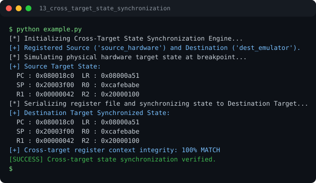

# Run report: 13_cross_target_state_synchronization

Generated by `run_all_and_log.py`; everything below comes from a real local run of `example.py`.

## Status

| Field | Value |
|:--|:--|
| Example | `13_cross_target_state_synchronization` |
| Status | **PASS** |
| Exit code | `0` |
| Duration | 0.79 s |
| Output lines | 14 |
| Output size | 670 B |
| Command | `python example.py`, `./run.sh` or `.\run.ps1` (inside the example folder) |
| Interpreter | `python 3.12.0` |
| Artifacts | [run.log](run.log) - [run_screenshot.svg](run_screenshot.svg) - [Telegram PNG](../telegram_assets/13_cross_target_state_synchronization.png) |

## Screenshot



Telegram-ready raster copy: [`../telegram_assets/13_cross_target_state_synchronization.png`](../telegram_assets/13_cross_target_state_synchronization.png)

## Output

```text
[*] Initializing Cross-Target State Synchronization Engine...
[+] Registered Source ('source_hardware') and Destination ('dest_emulator').
[*] Simulating physical hardware target state at breakpoint...
[+] Source Target State:
  PC : 0x080018c0  LR : 0x08000a51
  SP : 0x20003f00  R0 : 0xcafebabe
  R1 : 0x00000042  R2 : 0x20000100
[*] Serializing register file and synchronizing state to Destination Target...
[+] Destination Target Synchronized State:
  PC : 0x080018c0  LR : 0x08000a51
  SP : 0x20003f00  R0 : 0xcafebabe
  R1 : 0x00000042  R2 : 0x20000100
[+] Cross-target register context integrity: 100% MATCH
[SUCCESS] Cross-target state synchronization verified.
```
