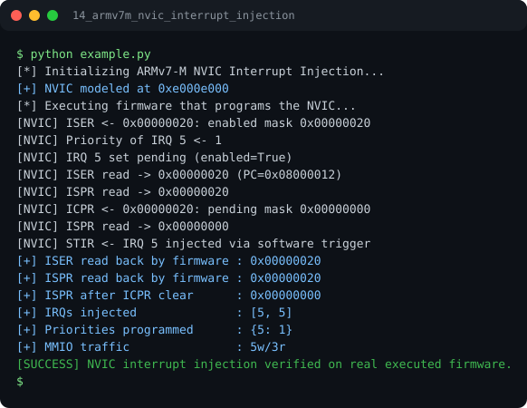

# Run report: 14_armv7m_nvic_interrupt_injection

Generated by `run_all_and_log.py`; everything below comes from a real local run of `example.py`.

## Status

| Field | Value |
|:--|:--|
| Example | `14_armv7m_nvic_interrupt_injection` |
| Status | **PASS** |
| Exit code | `0` |
| Duration | 0.77 s |
| Output lines | 18 |
| Output size | 787 B |
| Command | `python example.py`, `./run.sh` or `.\run.ps1` (inside the example folder) |
| Interpreter | `python 3.12.0` |
| Artifacts | [run.log](run.log) - [run_screenshot.svg](run_screenshot.svg) - [Telegram PNG](../telegram_assets/14_armv7m_nvic_interrupt_injection.png) |

## Screenshot



Telegram-ready raster copy: [`../telegram_assets/14_armv7m_nvic_interrupt_injection.png`](../telegram_assets/14_armv7m_nvic_interrupt_injection.png)

## Output

```text
[*] Initializing ARMv7-M NVIC Interrupt Injection...
[+] NVIC modeled at 0xe000e000
[*] Executing firmware that programs the NVIC...
[NVIC] ISER <- 0x00000020: enabled mask 0x00000020
[NVIC] Priority of IRQ 5 <- 1
[NVIC] IRQ 5 set pending (enabled=True)
[NVIC] ISER read -> 0x00000020 (PC=0x08000012)
[NVIC] ISPR read -> 0x00000020
[NVIC] ICPR <- 0x00000020: pending mask 0x00000000
[NVIC] ISPR read -> 0x00000000
[NVIC] STIR <- IRQ 5 injected via software trigger
[+] ISER read back by firmware : 0x00000020
[+] ISPR read back by firmware : 0x00000020
[+] ISPR after ICPR clear      : 0x00000000
[+] IRQs injected              : [5, 5]
[+] Priorities programmed      : {5: 1}
[+] MMIO traffic               : 5w/3r
[SUCCESS] NVIC interrupt injection verified on real executed firmware.
```
