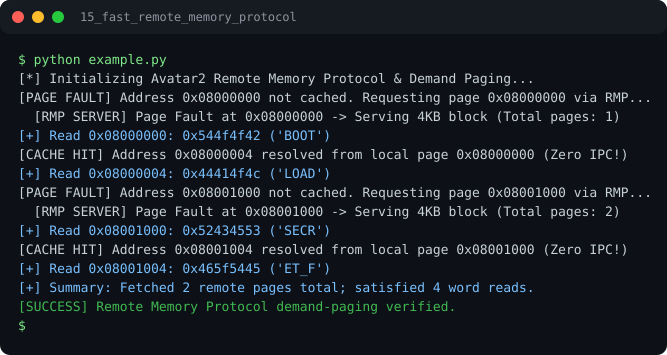

# Run report: 15_fast_remote_memory_protocol

Generated by `run_all_and_log.py`; everything below comes from a real local run of `example.py`.

## Status

| Field | Value |
|:--|:--|
| Example | `15_fast_remote_memory_protocol` |
| Status | **PASS** |
| Exit code | `0` |
| Duration | 0.76 s |
| Output lines | 13 |
| Output size | 833 B |
| Command | `python example.py`, `./run.sh` or `.\run.ps1` (inside the example folder) |
| Interpreter | `python 3.12.0` |
| Artifacts | [run.log](run.log) - [run_screenshot.svg](run_screenshot.svg) - [Telegram PNG](../telegram_assets/15_fast_remote_memory_protocol.png) |

## Screenshot



Telegram-ready raster copy: [`../telegram_assets/15_fast_remote_memory_protocol.png`](../telegram_assets/15_fast_remote_memory_protocol.png)

## Output

```text
[*] Initializing Avatar2 Remote Memory Protocol & Demand Paging...
[PAGE FAULT] Address 0x08000000 not cached. Requesting page 0x08000000 via RMP...
  [RMP SERVER] Page Fault at 0x08000000 -> Serving 4KB block (Total pages: 1)
[+] Read 0x08000000: 0x544f4f42 ('BOOT')
[CACHE HIT] Address 0x08000004 resolved from local page 0x08000000 (Zero IPC!)
[+] Read 0x08000004: 0x44414f4c ('LOAD')
[PAGE FAULT] Address 0x08001000 not cached. Requesting page 0x08001000 via RMP...
  [RMP SERVER] Page Fault at 0x08001000 -> Serving 4KB block (Total pages: 2)
[+] Read 0x08001000: 0x52434553 ('SECR')
[CACHE HIT] Address 0x08001004 resolved from local page 0x08001000 (Zero IPC!)
[+] Read 0x08001004: 0x465f5445 ('ET_F')
[+] Summary: Fetched 2 remote pages total; satisfied 4 word reads.
[SUCCESS] Remote Memory Protocol demand-paging verified.
```
