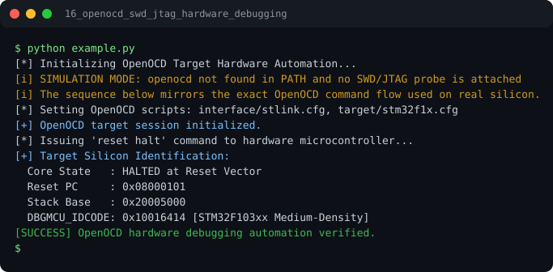

# Run report: 16_openocd_swd_jtag_hardware_debugging

Generated by `run_all_and_log.py`; everything below comes from a real local run of `example.py`.

## Status

| Field | Value |
|:--|:--|
| Example | `16_openocd_swd_jtag_hardware_debugging` |
| Status | **PASS** |
| Exit code | `0` |
| Duration | 0.77 s |
| Output lines | 12 |
| Output size | 641 B |
| Command | `python example.py`, `./run.sh` or `.\run.ps1` (inside the example folder) |
| Interpreter | `python 3.12.0` |
| Artifacts | [run.log](run.log) - [run_screenshot.svg](run_screenshot.svg) - [Telegram PNG](../telegram_assets/16_openocd_swd_jtag_hardware_debugging.png) |

## Screenshot



Telegram-ready raster copy: [`../telegram_assets/16_openocd_swd_jtag_hardware_debugging.png`](../telegram_assets/16_openocd_swd_jtag_hardware_debugging.png)

## Output

```text
[*] Initializing OpenOCD Target Hardware Automation...
[i] SIMULATION MODE: openocd not found in PATH and no SWD/JTAG probe is attached
[i] The sequence below mirrors the exact OpenOCD command flow used on real silicon.
[*] Setting OpenOCD scripts: interface/stlink.cfg, target/stm32f1x.cfg
[+] OpenOCD target session initialized.
[*] Issuing 'reset halt' command to hardware microcontroller...
[+] Target Silicon Identification:
  Core State   : HALTED at Reset Vector
  Reset PC     : 0x08000101
  Stack Base   : 0x20005000
  DBGMCU_IDCODE: 0x10016414 [STM32F103xx Medium-Density]
[SUCCESS] OpenOCD hardware debugging automation verified.
```
