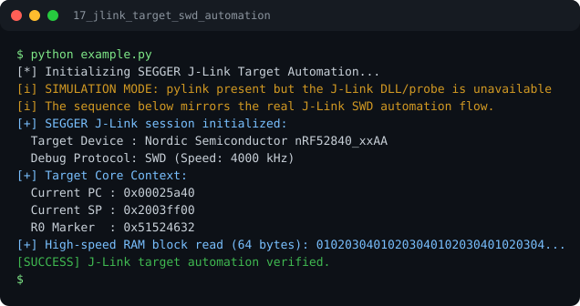

# Run report: 17_jlink_target_swd_automation

Generated by `run_all_and_log.py`; everything below comes from a real local run of `example.py`.

## Status

| Field | Value |
|:--|:--|
| Example | `17_jlink_target_swd_automation` |
| Status | **PASS** |
| Exit code | `0` |
| Duration | 0.75 s |
| Output lines | 12 |
| Output size | 554 B |
| Command | `python example.py`, `./run.sh` or `.\run.ps1` (inside the example folder) |
| Interpreter | `python 3.12.0` |
| Artifacts | [run.log](run.log) - [run_screenshot.svg](run_screenshot.svg) - [Telegram PNG](../telegram_assets/17_jlink_target_swd_automation.png) |

## Screenshot



Telegram-ready raster copy: [`../telegram_assets/17_jlink_target_swd_automation.png`](../telegram_assets/17_jlink_target_swd_automation.png)

## Output

```text
[*] Initializing SEGGER J-Link Target Automation...
[i] SIMULATION MODE: pylink present but the J-Link DLL/probe is unavailable
[i] The sequence below mirrors the real J-Link SWD automation flow.
[+] SEGGER J-Link session initialized:
  Target Device : Nordic Semiconductor nRF52840_xxAA
  Debug Protocol: SWD (Speed: 4000 kHz)
[+] Target Core Context:
  Current PC : 0x00025a40
  Current SP : 0x2003ff00
  R0 Marker  : 0x51524632
[+] High-speed RAM block read (64 bytes): 01020304010203040102030401020304...
[SUCCESS] J-Link target automation verified.
```
