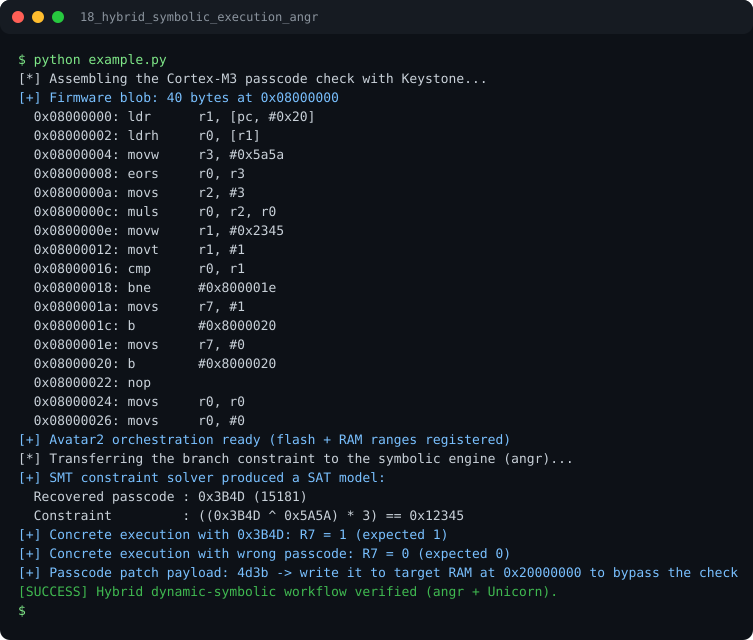

# Run report: 18_hybrid_symbolic_execution_angr

Generated by `run_all_and_log.py`; everything below comes from a real local run of `example.py`.

## Status

| Field | Value |
|:--|:--|
| Example | `18_hybrid_symbolic_execution_angr` |
| Status | **PASS** |
| Exit code | `0` |
| Duration | 3.07 s |
| Output lines | 28 |
| Output size | 1207 B |
| Command | `python example.py`, `./run.sh` or `.\run.ps1` (inside the example folder) |
| Interpreter | `python 3.12.0` |
| Artifacts | [run.log](run.log) - [run_screenshot.svg](run_screenshot.svg) - [Telegram PNG](../telegram_assets/18_hybrid_symbolic_execution_angr.png) |

## Screenshot



Telegram-ready raster copy: [`../telegram_assets/18_hybrid_symbolic_execution_angr.png`](../telegram_assets/18_hybrid_symbolic_execution_angr.png)

## Output

```text
[*] Assembling the Cortex-M3 passcode check with Keystone...
[+] Firmware blob: 40 bytes at 0x08000000
  0x08000000: ldr      r1, [pc, #0x20]
  0x08000002: ldrh     r0, [r1]
  0x08000004: movw     r3, #0x5a5a
  0x08000008: eors     r0, r3
  0x0800000a: movs     r2, #3
  0x0800000c: muls     r0, r2, r0
  0x0800000e: movw     r1, #0x2345
  0x08000012: movt     r1, #1
  0x08000016: cmp      r0, r1
  0x08000018: bne      #0x800001e
  0x0800001a: movs     r7, #1
  0x0800001c: b        #0x8000020
  0x0800001e: movs     r7, #0
  0x08000020: b        #0x8000020
  0x08000022: nop      
  0x08000024: movs     r0, r0
  0x08000026: movs     r0, #0
[+] Avatar2 orchestration ready (flash + RAM ranges registered)
[*] Transferring the branch constraint to the symbolic engine (angr)...
[+] SMT constraint solver produced a SAT model:
  Recovered passcode : 0x3B4D (15181)
  Constraint         : ((0x3B4D ^ 0x5A5A) * 3) == 0x12345
[+] Concrete execution with 0x3B4D: R7 = 1 (expected 1)
[+] Concrete execution with wrong passcode: R7 = 0 (expected 0)
[+] Passcode patch payload: 4d3b -> write it to target RAM at 0x20000000 to bypass the check
[SUCCESS] Hybrid dynamic-symbolic workflow verified (angr + Unicorn).
```
