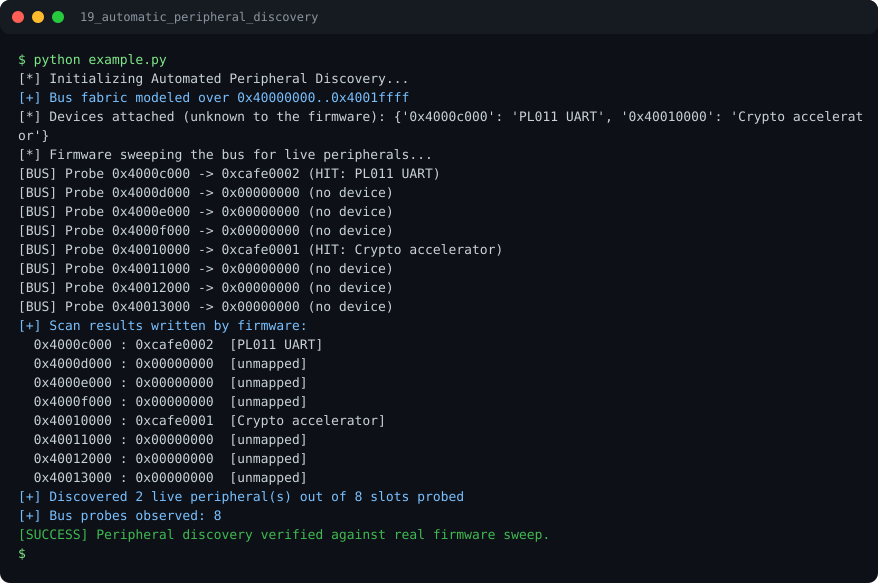

# Run report: 19_automatic_peripheral_discovery

Generated by `run_all_and_log.py`; everything below comes from a real local run of `example.py`.

## Status

| Field | Value |
|:--|:--|
| Example | `19_automatic_peripheral_discovery` |
| Status | **PASS** |
| Exit code | `0` |
| Duration | 0.78 s |
| Output lines | 24 |
| Output size | 1189 B |
| Command | `python example.py`, `./run.sh` or `.\run.ps1` (inside the example folder) |
| Interpreter | `python 3.12.0` |
| Artifacts | [run.log](run.log) - [run_screenshot.svg](run_screenshot.svg) - [Telegram PNG](../telegram_assets/19_automatic_peripheral_discovery.png) |

## Screenshot



Telegram-ready raster copy: [`../telegram_assets/19_automatic_peripheral_discovery.png`](../telegram_assets/19_automatic_peripheral_discovery.png)

## Output

```text
[*] Initializing Automated Peripheral Discovery...
[+] Bus fabric modeled over 0x40000000..0x4001ffff
[*] Devices attached (unknown to the firmware): {'0x4000c000': 'PL011 UART', '0x40010000': 'Crypto accelerator'}
[*] Firmware sweeping the bus for live peripherals...
[BUS] Probe 0x4000c000 -> 0xcafe0002 (HIT: PL011 UART)
[BUS] Probe 0x4000d000 -> 0x00000000 (no device)
[BUS] Probe 0x4000e000 -> 0x00000000 (no device)
[BUS] Probe 0x4000f000 -> 0x00000000 (no device)
[BUS] Probe 0x40010000 -> 0xcafe0001 (HIT: Crypto accelerator)
[BUS] Probe 0x40011000 -> 0x00000000 (no device)
[BUS] Probe 0x40012000 -> 0x00000000 (no device)
[BUS] Probe 0x40013000 -> 0x00000000 (no device)
[+] Scan results written by firmware:
  0x4000c000 : 0xcafe0002  [PL011 UART]
  0x4000d000 : 0x00000000  [unmapped]
  0x4000e000 : 0x00000000  [unmapped]
  0x4000f000 : 0x00000000  [unmapped]
  0x40010000 : 0xcafe0001  [Crypto accelerator]
  0x40011000 : 0x00000000  [unmapped]
  0x40012000 : 0x00000000  [unmapped]
  0x40013000 : 0x00000000  [unmapped]
[+] Discovered 2 live peripheral(s) out of 8 slots probed
[+] Bus probes observed: 8
[SUCCESS] Peripheral discovery verified against real firmware sweep.
```
