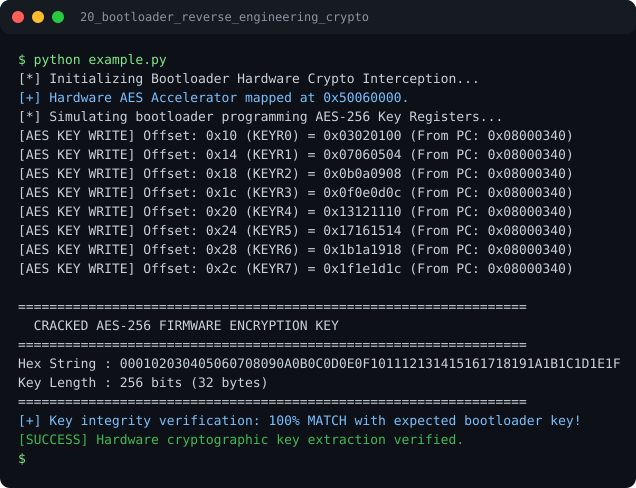

# Run report: 20_bootloader_reverse_engineering_crypto

Generated by `run_all_and_log.py`; everything below comes from a real local run of `example.py`.

## Status

| Field | Value |
|:--|:--|
| Example | `20_bootloader_reverse_engineering_crypto` |
| Status | **PASS** |
| Exit code | `0` |
| Duration | 0.81 s |
| Output lines | 20 |
| Output size | 1233 B |
| Command | `python example.py`, `./run.sh` or `.\run.ps1` (inside the example folder) |
| Interpreter | `python 3.12.0` |
| Artifacts | [run.log](run.log) - [run_screenshot.svg](run_screenshot.svg) - [Telegram PNG](../telegram_assets/20_bootloader_reverse_engineering_crypto.png) |

## Screenshot



Telegram-ready raster copy: [`../telegram_assets/20_bootloader_reverse_engineering_crypto.png`](../telegram_assets/20_bootloader_reverse_engineering_crypto.png)

## Output

```text
[*] Initializing Bootloader Hardware Crypto Interception...
[+] Hardware AES Accelerator mapped at 0x50060000.
[*] Simulating bootloader programming AES-256 Key Registers...
[AES KEY WRITE] Offset: 0x10 (KEYR0) = 0x03020100 (From PC: 0x08000340)
[AES KEY WRITE] Offset: 0x14 (KEYR1) = 0x07060504 (From PC: 0x08000340)
[AES KEY WRITE] Offset: 0x18 (KEYR2) = 0x0b0a0908 (From PC: 0x08000340)
[AES KEY WRITE] Offset: 0x1c (KEYR3) = 0x0f0e0d0c (From PC: 0x08000340)
[AES KEY WRITE] Offset: 0x20 (KEYR4) = 0x13121110 (From PC: 0x08000340)
[AES KEY WRITE] Offset: 0x24 (KEYR5) = 0x17161514 (From PC: 0x08000340)
[AES KEY WRITE] Offset: 0x28 (KEYR6) = 0x1b1a1918 (From PC: 0x08000340)
[AES KEY WRITE] Offset: 0x2c (KEYR7) = 0x1f1e1d1c (From PC: 0x08000340)

=================================================================
  CRACKED AES-256 FIRMWARE ENCRYPTION KEY
=================================================================
Hex String : 000102030405060708090A0B0C0D0E0F101112131415161718191A1B1C1D1E1F
Key Length : 256 bits (32 bytes)
=================================================================
[+] Key integrity verification: 100% MATCH with expected bootloader key!
[SUCCESS] Hardware cryptographic key extraction verified.
```
