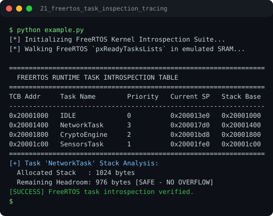

# Run report: 21_freertos_task_inspection_tracing

Generated by `run_all_and_log.py`; everything below comes from a real local run of `example.py`.

## Status

| Field | Value |
|:--|:--|
| Example | `21_freertos_task_inspection_tracing` |
| Status | **PASS** |
| Exit code | `0` |
| Duration | 0.76 s |
| Output lines | 17 |
| Output size | 924 B |
| Command | `python example.py`, `./run.sh` or `.\run.ps1` (inside the example folder) |
| Interpreter | `python 3.12.0` |
| Artifacts | [run.log](run.log) - [run_screenshot.svg](run_screenshot.svg) - [Telegram PNG](../telegram_assets/21_freertos_task_inspection_tracing.png) |

## Screenshot



Telegram-ready raster copy: [`../telegram_assets/21_freertos_task_inspection_tracing.png`](../telegram_assets/21_freertos_task_inspection_tracing.png)

## Output

```text
[*] Initializing FreeRTOS Kernel Introspection Suite...
[*] Walking FreeRTOS `pxReadyTasksLists` in emulated SRAM...

=================================================================
  FREERTOS RUNTIME TASK INTROSPECTION TABLE
=================================================================
TCB Addr     Task Name        Priority   Current SP   Stack Base
-----------------------------------------------------------------
0x20001000   IDLE             0          0x200013e0   0x20001000
0x20001400   NetworkTask      3          0x200017d0   0x20001400
0x20001800   CryptoEngine     2          0x20001bd8   0x20001800
0x20001c00   SensorsTask      1          0x20001fe0   0x20001c00
=================================================================
[+] Task 'NetworkTask' Stack Analysis:
  Allocated Stack   : 1024 bytes
  Remaining Headroom: 976 bytes [SAFE - NO OVERFLOW]
[SUCCESS] FreeRTOS task introspection verified.
```
