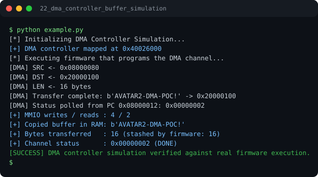

# Run report: 22_dma_controller_buffer_simulation

Generated by `run_all_and_log.py`; everything below comes from a real local run of `example.py`.

## Status

| Field | Value |
|:--|:--|
| Example | `22_dma_controller_buffer_simulation` |
| Status | **PASS** |
| Exit code | `0` |
| Duration | 0.71 s |
| Output lines | 13 |
| Output size | 577 B |
| Command | `python example.py`, `./run.sh` or `.\run.ps1` (inside the example folder) |
| Interpreter | `python 3.12.0` |
| Artifacts | [run.log](run.log) - [run_screenshot.svg](run_screenshot.svg) - [Telegram PNG](../telegram_assets/22_dma_controller_buffer_simulation.png) |

## Screenshot



Telegram-ready raster copy: [`../telegram_assets/22_dma_controller_buffer_simulation.png`](../telegram_assets/22_dma_controller_buffer_simulation.png)

## Output

```text
[*] Initializing DMA Controller Simulation...
[+] DMA controller mapped at 0x40026000
[*] Executing firmware that programs the DMA channel...
[DMA] SRC <- 0x08000080
[DMA] DST <- 0x20000100
[DMA] LEN <- 16 bytes
[DMA] Transfer complete: b'AVATAR2-DMA-POC!' -> 0x20000100
[DMA] Status polled from PC 0x08000012: 0x00000002
[+] MMIO writes / reads : 4 / 2
[+] Copied buffer in RAM: b'AVATAR2-DMA-POC!'
[+] Bytes transferred   : 16 (stashed by firmware: 16)
[+] Channel status      : 0x00000002 (DONE)
[SUCCESS] DMA controller simulation verified against real firmware execution.
```
