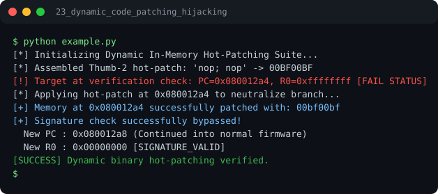

# Run report: 23_dynamic_code_patching_hijacking

Generated by `run_all_and_log.py`; everything below comes from a real local run of `example.py`.

## Status

| Field | Value |
|:--|:--|
| Example | `23_dynamic_code_patching_hijacking` |
| Status | **PASS** |
| Exit code | `0` |
| Duration | 0.79 s |
| Output lines | 9 |
| Output size | 498 B |
| Command | `python example.py`, `./run.sh` or `.\run.ps1` (inside the example folder) |
| Interpreter | `python 3.12.0` |
| Artifacts | [run.log](run.log) - [run_screenshot.svg](run_screenshot.svg) - [Telegram PNG](../telegram_assets/23_dynamic_code_patching_hijacking.png) |

## Screenshot



Telegram-ready raster copy: [`../telegram_assets/23_dynamic_code_patching_hijacking.png`](../telegram_assets/23_dynamic_code_patching_hijacking.png)

## Output

```text
[*] Initializing Dynamic In-Memory Hot-Patching Suite...
[*] Assembled Thumb-2 hot-patch: 'nop; nop' -> 00BF00BF
[!] Target at verification check: PC=0x080012a4, R0=0xffffffff [FAIL STATUS]
[*] Applying hot-patch at 0x080012a4 to neutralize branch...
[+] Memory at 0x080012a4 successfully patched with: 00bf00bf
[+] Signature check successfully bypassed!
  New PC : 0x080012a8 (Continued into normal firmware)
  New R0 : 0x00000000 [SIGNATURE_VALID]
[SUCCESS] Dynamic binary hot-patching verified.
```
