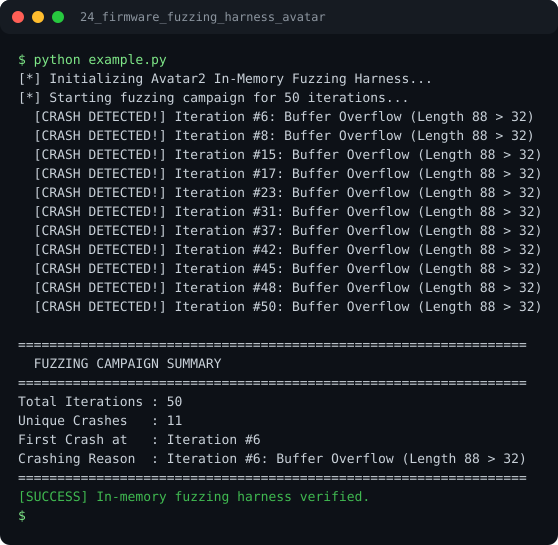

# Run report: 24_firmware_fuzzing_harness_avatar

Generated by `run_all_and_log.py`; everything below comes from a real local run of `example.py`.

## Status

| Field | Value |
|:--|:--|
| Example | `24_firmware_fuzzing_harness_avatar` |
| Status | **PASS** |
| Exit code | `0` |
| Duration | 0.75 s |
| Output lines | 23 |
| Output size | 1265 B |
| Command | `python example.py`, `./run.sh` or `.\run.ps1` (inside the example folder) |
| Interpreter | `python 3.12.0` |
| Artifacts | [run.log](run.log) - [run_screenshot.svg](run_screenshot.svg) - [Telegram PNG](../telegram_assets/24_firmware_fuzzing_harness_avatar.png) |

## Screenshot



Telegram-ready raster copy: [`../telegram_assets/24_firmware_fuzzing_harness_avatar.png`](../telegram_assets/24_firmware_fuzzing_harness_avatar.png)

## Output

```text
[*] Initializing Avatar2 In-Memory Fuzzing Harness...
[*] Starting fuzzing campaign for 50 iterations...
  [CRASH DETECTED!] Iteration #6: Buffer Overflow (Length 88 > 32)
  [CRASH DETECTED!] Iteration #8: Buffer Overflow (Length 88 > 32)
  [CRASH DETECTED!] Iteration #15: Buffer Overflow (Length 88 > 32)
  [CRASH DETECTED!] Iteration #17: Buffer Overflow (Length 88 > 32)
  [CRASH DETECTED!] Iteration #23: Buffer Overflow (Length 88 > 32)
  [CRASH DETECTED!] Iteration #31: Buffer Overflow (Length 88 > 32)
  [CRASH DETECTED!] Iteration #37: Buffer Overflow (Length 88 > 32)
  [CRASH DETECTED!] Iteration #42: Buffer Overflow (Length 88 > 32)
  [CRASH DETECTED!] Iteration #45: Buffer Overflow (Length 88 > 32)
  [CRASH DETECTED!] Iteration #48: Buffer Overflow (Length 88 > 32)
  [CRASH DETECTED!] Iteration #50: Buffer Overflow (Length 88 > 32)

=================================================================
  FUZZING CAMPAIGN SUMMARY
=================================================================
Total Iterations : 50
Unique Crashes   : 11
First Crash at   : Iteration #6
Crashing Reason  : Iteration #6: Buffer Overflow (Length 88 > 32)
=================================================================
[SUCCESS] In-memory fuzzing harness verified.
```
