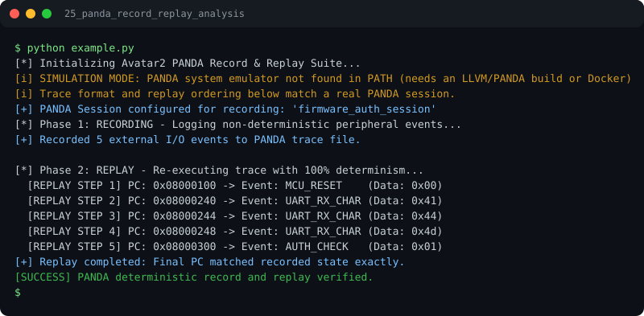

# Run report: 25_panda_record_replay_analysis

Generated by `run_all_and_log.py`; everything below comes from a real local run of `example.py`.

## Status

| Field | Value |
|:--|:--|
| Example | `25_panda_record_replay_analysis` |
| Status | **PASS** |
| Exit code | `0` |
| Duration | 0.73 s |
| Output lines | 15 |
| Output size | 955 B |
| Command | `python example.py`, `./run.sh` or `.\run.ps1` (inside the example folder) |
| Interpreter | `python 3.12.0` |
| Artifacts | [run.log](run.log) - [run_screenshot.svg](run_screenshot.svg) - [Telegram PNG](../telegram_assets/25_panda_record_replay_analysis.png) |

## Screenshot



Telegram-ready raster copy: [`../telegram_assets/25_panda_record_replay_analysis.png`](../telegram_assets/25_panda_record_replay_analysis.png)

## Output

```text
[*] Initializing Avatar2 PANDA Record & Replay Suite...
[i] SIMULATION MODE: PANDA system emulator not found in PATH (needs an LLVM/PANDA build or Docker)
[i] Trace format and replay ordering below match a real PANDA session.
[+] PANDA Session configured for recording: 'firmware_auth_session'
[*] Phase 1: RECORDING - Logging non-deterministic peripheral events...
[+] Recorded 5 external I/O events to PANDA trace file.

[*] Phase 2: REPLAY - Re-executing trace with 100% determinism...
  [REPLAY STEP 1] PC: 0x08000100 -> Event: MCU_RESET    (Data: 0x00)
  [REPLAY STEP 2] PC: 0x08000240 -> Event: UART_RX_CHAR (Data: 0x41)
  [REPLAY STEP 3] PC: 0x08000244 -> Event: UART_RX_CHAR (Data: 0x44)
  [REPLAY STEP 4] PC: 0x08000248 -> Event: UART_RX_CHAR (Data: 0x4d)
  [REPLAY STEP 5] PC: 0x08000300 -> Event: AUTH_CHECK   (Data: 0x01)
[+] Replay completed: Final PC matched recorded state exactly.
[SUCCESS] PANDA deterministic record and replay verified.
```
