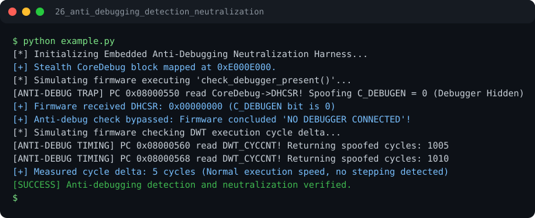

# Run report: 26_anti_debugging_detection_neutralization

Generated by `run_all_and_log.py`; everything below comes from a real local run of `example.py`.

## Status

| Field | Value |
|:--|:--|
| Example | `26_anti_debugging_detection_neutralization` |
| Status | **PASS** |
| Exit code | `0` |
| Duration | 0.78 s |
| Output lines | 11 |
| Output size | 785 B |
| Command | `python example.py`, `./run.sh` or `.\run.ps1` (inside the example folder) |
| Interpreter | `python 3.12.0` |
| Artifacts | [run.log](run.log) - [run_screenshot.svg](run_screenshot.svg) - [Telegram PNG](../telegram_assets/26_anti_debugging_detection_neutralization.png) |

## Screenshot



Telegram-ready raster copy: [`../telegram_assets/26_anti_debugging_detection_neutralization.png`](../telegram_assets/26_anti_debugging_detection_neutralization.png)

## Output

```text
[*] Initializing Embedded Anti-Debugging Neutralization Harness...
[+] Stealth CoreDebug block mapped at 0xE000E000.
[*] Simulating firmware executing 'check_debugger_present()'...
[ANTI-DEBUG TRAP] PC 0x08000550 read CoreDebug->DHCSR! Spoofing C_DEBUGEN = 0 (Debugger Hidden)
[+] Firmware received DHCSR: 0x00000000 (C_DEBUGEN bit is 0)
[+] Anti-debug check bypassed: Firmware concluded 'NO DEBUGGER CONNECTED'!
[*] Simulating firmware checking DWT execution cycle delta...
[ANTI-DEBUG TIMING] PC 0x08000560 read DWT_CYCCNT! Returning spoofed cycles: 1005
[ANTI-DEBUG TIMING] PC 0x08000568 read DWT_CYCCNT! Returning spoofed cycles: 1010
[+] Measured cycle delta: 5 cycles (Normal execution speed, no stepping detected)
[SUCCESS] Anti-debugging detection and neutralization verified.
```
