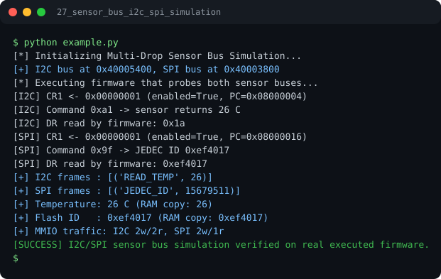

# Run report: 27_sensor_bus_i2c_spi_simulation

Generated by `run_all_and_log.py`; everything below comes from a real local run of `example.py`.

## Status

| Field | Value |
|:--|:--|
| Example | `27_sensor_bus_i2c_spi_simulation` |
| Status | **PASS** |
| Exit code | `0` |
| Duration | 0.71 s |
| Output lines | 15 |
| Output size | 694 B |
| Command | `python example.py`, `./run.sh` or `.\run.ps1` (inside the example folder) |
| Interpreter | `python 3.12.0` |
| Artifacts | [run.log](run.log) - [run_screenshot.svg](run_screenshot.svg) - [Telegram PNG](../telegram_assets/27_sensor_bus_i2c_spi_simulation.png) |

## Screenshot



Telegram-ready raster copy: [`../telegram_assets/27_sensor_bus_i2c_spi_simulation.png`](../telegram_assets/27_sensor_bus_i2c_spi_simulation.png)

## Output

```text
[*] Initializing Multi-Drop Sensor Bus Simulation...
[+] I2C bus at 0x40005400, SPI bus at 0x40003800
[*] Executing firmware that probes both sensor buses...
[I2C] CR1 <- 0x00000001 (enabled=True, PC=0x08000004)
[I2C] Command 0xa1 -> sensor returns 26 C
[I2C] DR read by firmware: 0x1a
[SPI] CR1 <- 0x00000001 (enabled=True, PC=0x08000016)
[SPI] Command 0x9f -> JEDEC ID 0xef4017
[SPI] DR read by firmware: 0xef4017
[+] I2C frames : [('READ_TEMP', 26)]
[+] SPI frames : [('JEDEC_ID', 15679511)]
[+] Temperature: 26 C (RAM copy: 26)
[+] Flash ID   : 0xef4017 (RAM copy: 0xef4017)
[+] MMIO traffic: I2C 2w/2r, SPI 2w/1r
[SUCCESS] I2C/SPI sensor bus simulation verified on real executed firmware.
```
