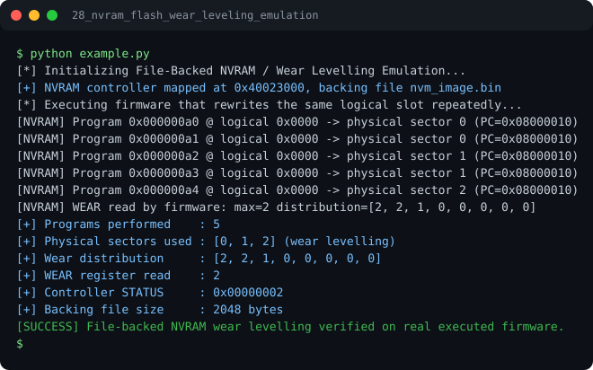

# Run report: 28_nvram_flash_wear_leveling_emulation

Generated by `run_all_and_log.py`; everything below comes from a real local run of `example.py`.

## Status

| Field | Value |
|:--|:--|
| Example | `28_nvram_flash_wear_leveling_emulation` |
| Status | **PASS** |
| Exit code | `0` |
| Duration | 0.83 s |
| Output lines | 16 |
| Output size | 1013 B |
| Command | `python example.py`, `./run.sh` or `.\run.ps1` (inside the example folder) |
| Interpreter | `python 3.12.0` |
| Artifacts | [run.log](run.log) - [run_screenshot.svg](run_screenshot.svg) - [Telegram PNG](../telegram_assets/28_nvram_flash_wear_leveling_emulation.png) |

## Screenshot



Telegram-ready raster copy: [`../telegram_assets/28_nvram_flash_wear_leveling_emulation.png`](../telegram_assets/28_nvram_flash_wear_leveling_emulation.png)

## Output

```text
[*] Initializing File-Backed NVRAM / Wear Levelling Emulation...
[+] NVRAM controller mapped at 0x40023000, backing file nvm_image.bin
[*] Executing firmware that rewrites the same logical slot repeatedly...
[NVRAM] Program 0x000000a0 @ logical 0x0000 -> physical sector 0 (PC=0x08000010)
[NVRAM] Program 0x000000a1 @ logical 0x0000 -> physical sector 0 (PC=0x08000010)
[NVRAM] Program 0x000000a2 @ logical 0x0000 -> physical sector 1 (PC=0x08000010)
[NVRAM] Program 0x000000a3 @ logical 0x0000 -> physical sector 1 (PC=0x08000010)
[NVRAM] Program 0x000000a4 @ logical 0x0000 -> physical sector 2 (PC=0x08000010)
[NVRAM] WEAR read by firmware: max=2 distribution=[2, 2, 1, 0, 0, 0, 0, 0]
[+] Programs performed    : 5
[+] Physical sectors used : [0, 1, 2] (wear levelling)
[+] Wear distribution     : [2, 2, 1, 0, 0, 0, 0, 0]
[+] WEAR register read    : 2
[+] Controller STATUS     : 0x00000002
[+] Backing file size     : 2048 bytes
[SUCCESS] File-backed NVRAM wear levelling verified on real executed firmware.
```
