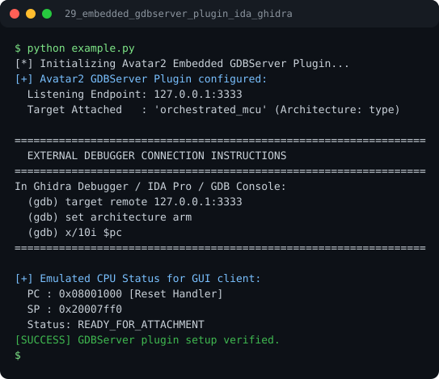

# Run report: 29_embedded_gdbserver_plugin_ida_ghidra

Generated by `run_all_and_log.py`; everything below comes from a real local run of `example.py`.

## Status

| Field | Value |
|:--|:--|
| Example | `29_embedded_gdbserver_plugin_ida_ghidra` |
| Status | **PASS** |
| Exit code | `0` |
| Duration | 0.78 s |
| Output lines | 19 |
| Output size | 732 B |
| Command | `python example.py`, `./run.sh` or `.\run.ps1` (inside the example folder) |
| Interpreter | `python 3.12.0` |
| Artifacts | [run.log](run.log) - [run_screenshot.svg](run_screenshot.svg) - [Telegram PNG](../telegram_assets/29_embedded_gdbserver_plugin_ida_ghidra.png) |

## Screenshot



Telegram-ready raster copy: [`../telegram_assets/29_embedded_gdbserver_plugin_ida_ghidra.png`](../telegram_assets/29_embedded_gdbserver_plugin_ida_ghidra.png)

## Output

```text
[*] Initializing Avatar2 Embedded GDBServer Plugin...
[+] Avatar2 GDBServer Plugin configured:
  Listening Endpoint: 127.0.0.1:3333
  Target Attached   : 'orchestrated_mcu' (Architecture: type)

=================================================================
  EXTERNAL DEBUGGER CONNECTION INSTRUCTIONS
=================================================================
In Ghidra Debugger / IDA Pro / GDB Console:
  (gdb) target remote 127.0.0.1:3333
  (gdb) set architecture arm
  (gdb) x/10i $pc
=================================================================

[+] Emulated CPU Status for GUI client:
  PC : 0x08001000 [Reset Handler]
  SP : 0x20007ff0
  Status: READY_FOR_ATTACHMENT
[SUCCESS] GDBServer plugin setup verified.
```
