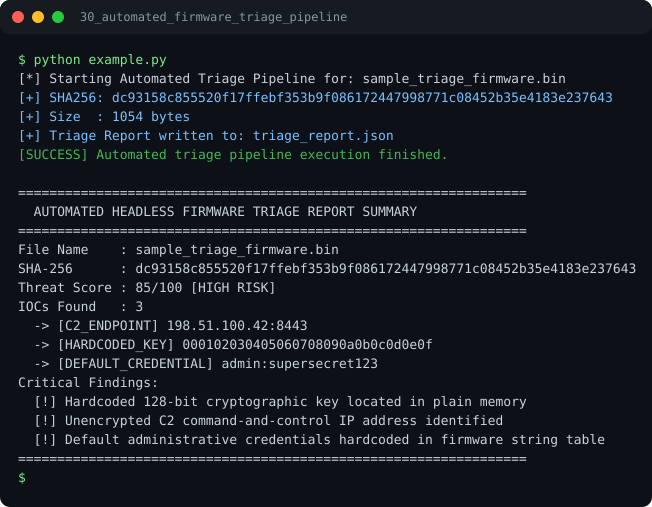

# Run report: 30_automated_firmware_triage_pipeline

Generated by `run_all_and_log.py`; everything below comes from a real local run of `example.py`.

## Status

| Field | Value |
|:--|:--|
| Example | `30_automated_firmware_triage_pipeline` |
| Status | **PASS** |
| Exit code | `0` |
| Duration | 0.80 s |
| Output lines | 21 |
| Output size | 1063 B |
| Command | `python example.py`, `./run.sh` or `.\run.ps1` (inside the example folder) |
| Interpreter | `python 3.12.0` |
| Artifacts | [run.log](run.log) - [run_screenshot.svg](run_screenshot.svg) - [Telegram PNG](../telegram_assets/30_automated_firmware_triage_pipeline.png) |

## Screenshot



Telegram-ready raster copy: [`../telegram_assets/30_automated_firmware_triage_pipeline.png`](../telegram_assets/30_automated_firmware_triage_pipeline.png)

## Output

```text
[*] Starting Automated Triage Pipeline for: sample_triage_firmware.bin
[+] SHA256: dc93158c855520f17ffebf353b9f086172447998771c08452b35e4183e237643
[+] Size  : 1054 bytes
[+] Triage Report written to: triage_report.json
[SUCCESS] Automated triage pipeline execution finished.

=================================================================
  AUTOMATED HEADLESS FIRMWARE TRIAGE REPORT SUMMARY
=================================================================
File Name    : sample_triage_firmware.bin
SHA-256      : dc93158c855520f17ffebf353b9f086172447998771c08452b35e4183e237643
Threat Score : 85/100 [HIGH RISK]
IOCs Found   : 3
  -> [C2_ENDPOINT] 198.51.100.42:8443
  -> [HARDCODED_KEY] 000102030405060708090a0b0c0d0e0f
  -> [DEFAULT_CREDENTIAL] admin:supersecret123
Critical Findings:
  [!] Hardcoded 128-bit cryptographic key located in plain memory
  [!] Unencrypted C2 command-and-control IP address identified
  [!] Default administrative credentials hardcoded in firmware string table
=================================================================
```
