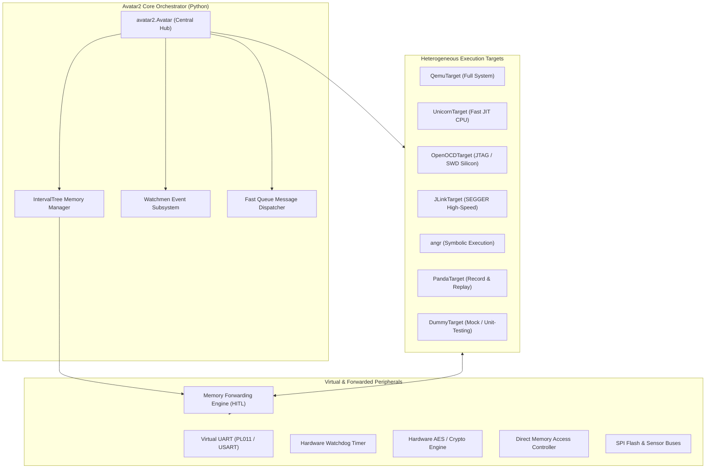

# ⚡️ Avatar2 Framework: Advanced Multi-Target Firmware Orchestration Playbook

[](https://www.python.org/downloads/)
[](https://github.com/avatartwo/avatar2)
[](https://github.com/avatartwo/avatar2)
[](https://github.com/avatartwo/avatar2)
[](https://t.me/OxxxSec)
[](verify_all.py)

A comprehensive, publication-ready technical playbook and **30-part Telegram post series** exploring practical embedded firmware dynamic analysis, hardware-in-the-loop (HITL) memory forwarding, peripheral modeling, vulnerability research, and automated security triage using the [Avatar2 Framework](https://github.com/avatartwo/avatar2).

> 📢 **Telegram Channel**: Follow [@OxxxSec](https://t.me/OxxxSec) for cutting-edge binary analysis, firmware security, and reverse engineering playbooks!

---

## 📑 Table of Contents (30-Part Master Series)

| # | Topic & Directory | Core Emulation / Analysis Focus |
|:---:|:---|:---|
| **01** | [01_orchestrator_initialization_architecture](01_orchestrator_initialization_architecture/) | Avatar2 Core Orchestrator Initialization & Architecture Lifecycle |
| **02** | [02_granular_memory_mapping_layout](02_granular_memory_mapping_layout/) | Granular Address Space Configuration & Memory Range Protection |
| **03** | [03_dummy_target_mock_execution](03_dummy_target_mock_execution/) | Mock Target Orchestration and Unit-Testing without Physical Hardware |
| **04** | [04_unicorn_fast_cpu_emulation](04_unicorn_fast_cpu_emulation/) | High-Performance JIT CPU Emulation with the Unicorn Engine |
| **05** | [05_gdb_target_remote_rsp_control](05_gdb_target_remote_rsp_control/) | GDB Remote Serial Protocol (RSP) Target Control & Instrumentation |
| **06** | [06_qemu_full_system_arm_target](06_qemu_full_system_arm_target/) | Full-System ARM Cortex-M Emulation on a Live QEMU Machine |
| **07** | [07_hardware_in_the_loop_memory_forwarding](07_hardware_in_the_loop_memory_forwarding/) | Hardware-in-the-Loop (HITL) Memory Forwarding Architecture |
| **08** | [08_python_peripheral_modeling_mmio](08_python_peripheral_modeling_mmio/) | Custom MMIO Peripheral Modeling with AvatarPeripheral |
| **09** | [09_virtual_uart_serial_telemetry](09_virtual_uart_serial_telemetry/) | Virtual UART Serial Console & Telemetry Capture |
| **10** | [10_hardware_timer_watchdog_simulation](10_hardware_timer_watchdog_simulation/) | Hardware Decrementing Timers & Watchdog Pet Simulation |
| **11** | [11_watchmen_event_driven_instrumentation](11_watchmen_event_driven_instrumentation/) | Asynchronous Target Event Instrumentation with Watchmen |
| **12** | [12_breakpoint_watchpoint_automation](12_breakpoint_watchpoint_automation/) | Automated Dynamic Breakpoints & Memory Access Watchpoints |
| **13** | [13_cross_target_state_synchronization](13_cross_target_state_synchronization/) | Heterogeneous Cross-Target State Synchronization |
| **14** | [14_armv7m_nvic_interrupt_injection](14_armv7m_nvic_interrupt_injection/) | ARMv7-M Nested Vectored Interrupt Controller (NVIC) & IRQ Injection |
| **15** | [15_fast_remote_memory_protocol](15_fast_remote_memory_protocol/) | High-Performance Remote Memory Protocol (RMP) & Demand-Paging |
| **16** | [16_openocd_swd_jtag_hardware_debugging](16_openocd_swd_jtag_hardware_debugging/) | Bare-Metal Microcontroller Debugging with OpenOCDTarget |
| **17** | [17_jlink_target_swd_automation](17_jlink_target_swd_automation/) | High-Speed SEGGER J-Link Hardware Debug Automation |
| **18** | [18_hybrid_symbolic_execution_angr](18_hybrid_symbolic_execution_angr/) | Hybrid Dynamic-Symbolic Firmware Analysis with angr |
| **19** | [19_automatic_peripheral_discovery](19_automatic_peripheral_discovery/) | Automated Unknown Peripheral Address Discovery & Mapping |
| **20** | [20_bootloader_reverse_engineering_crypto](20_bootloader_reverse_engineering_crypto/) | Embedded Bootloader Analysis & Hardware Crypto Key Extraction |
| **21** | [21_freertos_task_inspection_tracing](21_freertos_task_inspection_tracing/) | FreeRTOS Kernel Data Structure Introspection & Task Tracing |
| **22** | [22_dma_controller_buffer_simulation](22_dma_controller_buffer_simulation/) | Direct Memory Access (DMA) Controller & Circular Buffer Simulation |
| **23** | [23_dynamic_code_patching_hijacking](23_dynamic_code_patching_hijacking/) | Dynamic Binary Patching & Hot-Patching Firmware in Memory |
| **24** | [24_firmware_fuzzing_harness_avatar](24_firmware_fuzzing_harness_avatar/) | In-Memory Mutation Fuzzing Harness for Firmware Parsers |
| **25** | [25_panda_record_replay_analysis](25_panda_record_replay_analysis/) | Deterministic Execution Record & Replay with PandaTarget |
| **26** | [26_anti_debugging_detection_neutralization](26_anti_debugging_detection_neutralization/) | Embedded Anti-Debugging Detection & Neutralization |
| **27** | [27_sensor_bus_i2c_spi_simulation](27_sensor_bus_i2c_spi_simulation/) | Multi-Drop Sensor Bus Simulation (I2C & SPI Protocol Engines) |
| **28** | [28_nvram_flash_wear_leveling_emulation](28_nvram_flash_wear_leveling_emulation/) | Serial SPI Flash (NOR/NAND) & NVRAM File-Backed Emulation |
| **29** | [29_embedded_gdbserver_plugin_ida_ghidra](29_embedded_gdbserver_plugin_ida_ghidra/) | Exposing Orchestrated Targets to IDA Pro and Ghidra via GDBServer |
| **30** | [30_automated_firmware_triage_pipeline](30_automated_firmware_triage_pipeline/) | Production Headless Firmware Triage & IOC Threat Intelligence Pipeline |

---

## 🏗 Architectural Overview: Avatar2 Multi-Target Ecosystem



---

## 🚀 Quick Start

### 1. Automated Environment Setup

Use the bootstrap script for your platform:

#### Windows PowerShell:
```powershell
powershell -ExecutionPolicy Bypass -File .\setup_env.ps1
```

#### Windows Command Prompt (CMD):
```cmd
setup_env.bat
```

#### Linux / macOS / WSL:
```bash
chmod +x setup_env.sh
./setup_env.sh
```

---

### 2. Manual Environment Setup

```bash
# 1. Create virtual environment
python -m venv .venv

# 2. Activate virtual environment
# Windows PowerShell: .\.venv\Scripts\Activate.ps1
# Windows CMD: .\.venv\Scripts\activate.bat
# Linux / WSL: source .venv/bin/activate

# 3. Upgrade pip and setuptools
pip install --upgrade pip "setuptools<70" wheel

# 4. Install dependencies
pip install -r requirements.txt

# 5. Verify all 30 chapters
python verify_all.py
```

---

### 3. Running All 30 Examples & Generating Logs

To execute all 30 post examples sequentially, capture the real stdout/stderr of every example and print a
summary table:

```bash
python run_all_and_log.py
```

Each run writes three artifacts into every post folder:

| Artifact | Content |
|:--|:--|
| `<post>/run.log` | The untouched stdout (plus a `--- STDERR ---` section when the example wrote to stderr) |
| `<post>/run_report.md` | Markdown report: status table (exit code, duration, output size) + the captured output |
| `<post>/run_screenshot.svg` | Terminal-style screenshot of the real execution (renders inline on GitHub) |

Every post folder also ships its own launchers, so a single example can be started without touching the
repository root:

| Launcher | Platform |
|:--|:--|
| `<post>/run.sh` | Linux / macOS / WSL (`./run.sh`) |
| `<post>/run.ps1` | Windows PowerShell (`.\run.ps1`) |

Telegram-ready captures are exported to `telegram_assets/<post>.png` (one raster screenshot per
chapter, referenced from the Telegram series below). PNG export needs `pillow`; when it is not
installed the runner simply skips the PNG step and keeps the SVG screenshots.

---

## 📱 Telegram Series Publication

The complete 30-post series formatted specifically for posting directly to Telegram is compiled in:
- **[avatar2_telegram_posts_series.md](avatar2_telegram_posts_series.md)**

Each post contains:
- Catchy technical title and architectural hook
- Core concept bullet points explaining the underlying hardware and framework mechanics
- Complete, standalone, runnable Python implementation example
- 5 real-world security engineering use cases
- Critical caveats, timing rules, and responsible practice tips
- Target specs and sample binary layouts
- Curated community documentation and research links
- Relevant Telegram discoverability hashtags

---

## 📜 License

This project is licensed under the MIT License - see the [LICENSE](LICENSE) file for details.

---

**Maintained by [OxxxSec](https://t.me/OxxxSec)** | Dedicated to advancing embedded firmware security and binary dynamic analysis.